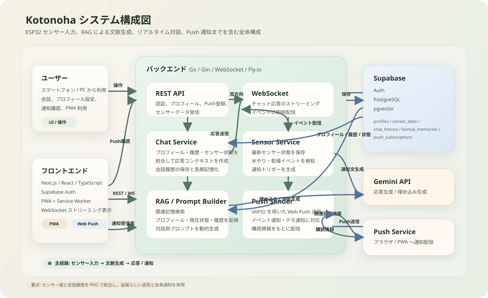
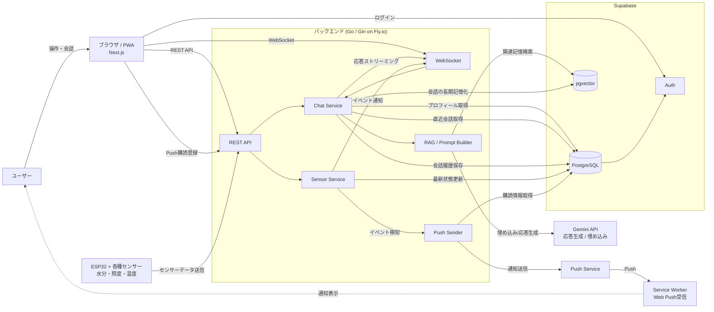

# システム構成図

`Kotonoha` の主要コンポーネントとデータの流れをまとめた構成図です。  
DCON のポスターや口頭説明では、まずこの図をベースに `センサー入力 -> 文脈生成 -> 応答/通知` の流れを説明すると通しやすいです。

## 画像版

## 全体構成

## データフロー

### 1. チャット

1. ユーザーが `Next.js` フロントエンドからメッセージを送信
2. `Go/Gin` バックエンドが `Supabase PostgreSQL` からプロフィール・直近履歴・センサー状態を取得
3. `pgvector` から関連する長期記憶を検索し、`RAG` 用コンテキストを構築
4. `Gemini` が返答を生成し、`WebSocket` でフロントへストリーミング送信
5. 会話ログは短期記憶として保存し、1往復ごとにベクトル化して長期記憶へ保存

### 2. センサー連携

1. `ESP32` が土壌水分・照度・温度をバックエンドへ送信
2. `Sensor Service` が最新状態を保存し、水やりや乾燥などのイベントを判定
3. イベント発生時は `WebSocket` でアプリへ即時反映
4. 必要に応じて `Web Push` でアプリ外にも通知

## ポスター向けに強調するとよい点

- `ESP32` による実世界センシング
- `RAG` による長期記憶検索
- `Gemini` を使った文脈依存の対話生成
- `WebSocket` によるリアルタイム会話
- `Web Push` による自発的な通知
