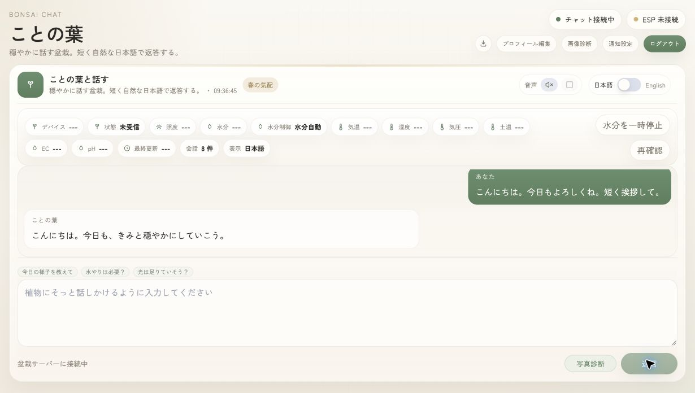

# MacでWebとAPIを動かし、ColabのLLMへ接続する

Next.js、Go API、認証用Supabase AuthとPostgreSQLをMacに置きます。ColabにはLLMと接続用トンネルだけを置きます。Macのスリープ・再起動・回線切断中はWebを利用できず、Colabの切断中は会話を生成できません。

## 公開経路

```text
ブラウザ → HTTPS (Tailscale Funnel) → Mac 127.0.0.1:8787
                                      ├─ /               → Next.js :3000
                                      ├─ /api/・/ws/      → Go API :8080
                                      └─ /supabase/auth/v1 → Supabase Auth :54321
Go API → PostgreSQL :54322
Go API → HTTPS・Bearer認証 → ColabのLLM /v1/chat/completions
```

Macの各サービスはloopbackで待ち受けます。公開プロキシからはAuthのログイン・更新・ログアウト等の限定した経路だけに接続でき、管理APIは公開しません。LLMキー、DBパスワード、Authの管理キーはブラウザへ渡しません。

## 初回設定

Node.js、npm、`backend/go.mod`に対応するGo、Python 3.9以上、Dockerを用意します。MacではOrbStack等のDockerエンジンを起動します。クラウドSupabaseを使う場合はローカルDBの準備を省略し、既存の接続情報を設定してください。

ローカルSupabaseは `deploy/mac/supabase/manage.py` で準備します。公開URLが決まってから実行してください。

```sh
python3 deploy/mac/supabase/manage.py prepare --site-url https://公開ホスト
python3 deploy/mac/supabase/manage.py start
python3 deploy/mac/supabase/manage.py migrate-new
python3 deploy/mac/supabase/manage.py create-demo-user
```

`migrate-new`は新規DB専用です。初期化履歴のない既存アプリDBへは実行しないでください。既存migrationにはベクトル記憶を消す処理が含まれます。データを保全する更新は個別に確認します。

サーバー設定を `backend/.env`、公開設定を `frontend/.env.local` に保存し、権限を0600にします。`.env`と`.runtime/`はGitの対象外です。`SUPABASE_PUBLISHABLE_KEY`にはローカル構成のanonキーも使用できます。

| 保存先 | 設定名 | 設定内容 |
| --- | --- | --- |
| backend | `SUPABASE_URL` | ローカルAuthは `http://127.0.0.1:8787/supabase` |
| backend | `SUPABASE_PUBLISHABLE_KEY`、`SUPABASE_SECRET_KEY`、`SUPABASE_DB_URL` | ローカル準備で生成した値、または既存クラウドの値 |
| backend | `SUPABASE_JWT_SECRET` | ローカル構成では空欄。Authサーバーで検証する |
| backend | `BACKEND_ALLOWED_ORIGIN` | 公開画面の `https://公開ホスト` |
| backend | `BACKEND_HOST` | `127.0.0.1` |
| backend | `LLM_PROVIDER` | 接続確認後は `openai-compatible`。未接続期間は `disabled` |
| backend | `LLM_BASE_URL`、`LLM_MODEL`、`LLM_API_KEY` | 実際の `/v1` URL、`/v1/models`で確認したID、同サーバーの認証キー |
| backend | `LLM_MAX_TOKENS`、`LLM_TIMEOUT_SECONDS` | 既定1024、120秒 |
| backend | `EMBEDDING_PROVIDER` | 埋め込み未設定なら `disabled` |
| frontend | `NEXT_PUBLIC_SUPABASE_URL` | ローカルAuthは `https://公開ホスト/supabase` |
| frontend | `NEXT_PUBLIC_SUPABASE_PUBLISHABLE_KEY` | 公開可能なanon/publishableキー |
| frontend | `NEXT_PUBLIC_API_BASE_URL`、`NEXT_PUBLIC_WS_URL` | 同一オリジン構成では空欄 |
| frontend | `NEXT_PUBLIC_AUTH_ALLOW_SIGNUP`、`NEXT_PUBLIC_AUTH_GOOGLE_ENABLED` | このローカル構成では `false` |

`NEXT_PUBLIC_*`はビルド時に取り込まれます。変更した場合は再ビルドしてください。サーバーだけの環境変数はAPIの再起動で反映します。

## 起動と公開

```sh
cd frontend
npm ci
cd ..
python3 deploy/mac/manage.py check
python3 deploy/mac/manage.py build
python3 deploy/mac/manage.py start
python3 deploy/mac/manage.py status
```

`status`でWebとAPI/DBの応答を確認してから、Tailscaleの既存設定と競合しないことを確認し、Funnelを設定します。

```sh
tailscale funnel status --json
tailscale funnel --bg --https=443 http://127.0.0.1:8787
```

Funnelの有効化が必要なアカウントでは、Tailscaleの案内に従います。既存の公開設定がある場合は上書きせず、ポート・ホストを調整してください。URLはコマンドの実行結果を使います。Funnelの設定は [公式CLI資料](https://tailscale.com/docs/reference/tailscale-cli/funnel) を参照してください。

起動したプロセスとログは `.runtime/` で管理します。Macの再起動後はDocker、Supabase、Webを再度起動します。起動スクリプトは自動ログインやOS起動設定を変更しません。サービスのどれかが終了した場合は関連するWeb/APIプロセスも停止します。ログを確認してから再起動してください。

## Colabの再接続

2026年11月6日に、同じノートブックのA100 80GBで `Qwen/Qwen3.8-27B` を起動しました。公開モデルIDは `qwen38-27b` です。Macから認証付きAPIと内容を含むSSE完了を確認し、`LLM_PROVIDER=openai-compatible` に切り替えました。

利用中のノートブックに接続し、既存サーバーの稼働を確認します。停止処理を含む古いセルを一括実行せず、必要なセルだけを実行してください。A100の割当失敗やreCAPTCHAエラーがある間は接続済みとして扱いません。

認証付き `/v1/models` でモデルIDを確認し、MacからSSEが完了することを確認してから `LLM_PROVIDER=openai-compatible` に切り替えます。サーバーの認証は無効にしないでください。ColabのURLやキーが変わった場合は `backend/.env` だけを更新し、APIを含むMac側プロセスを再起動します。

`deploy/colab/reconnect_cells.py` は、確認したノートブック構成から作成した個別実行用のセルです。モデルIDを推測で書き換えず、正常なサーバーがある場合は再利用します。キーをノートブック本文や出力に書かないでください。認証情報の設定とサーバー起動後は、次の補助スクリプトで未認証・誤ったキーの拒否、公開経路の制限、モデルID、SSE完了を検証してからMacの設定を更新できます。

LLMの公開APIは `GET /v1/models` と `POST /v1/chat/completions` の2本だけです。ngrokのTraffic Policyでメソッド・正規化後のパス・元のパスを照合し、それ以外は404で拒否します。許可したAPIではvLLMのBearer認証も必要です。vLLM 0.33.0の `--api-key` は特定の接頭辞だけを認証対象にするため、`/invocations` や `/load` 等の公開をこれだけで防ぐことはできません。根拠は [vLLM 0.33.0の認証処理](https://github.com/vllm-project/vllm/blob/v0.33.0/vllm/entrypoints/serve/middleware/authenticate.py)、[ngrokのリクエスト変数](https://ngrok.com/docs/gateway/traffic-policy/variables/req)、[ngrokの応答による拒否](https://ngrok.com/docs/gateway/traffic-policy/actions/custom-response) を参照してください。

セル5は同じ制限付きで作成したトンネルだけを再利用します。制限が確認できない既存トンネルがある場合は停止するので、対象を確認してそのトンネルだけを明示的に閉じ、古い `tunnel` 変数を削除してからセルを再実行してください。スクリプトが既存トンネルを自動で閉じることはありません。既存のvLLMプロセスが読み込み中の場合も、二重起動せず停止するので、起動状況とhealthを確認してから再実行してください。

```sh
python3 deploy/colab/configure_mac_llm.py \
  --base-url https://Colabの公開ホスト/v1 \
  --model 実際のモデルID \
  --env-file backend/.env
```

APIキーはターミナルで非表示入力します。`--key-file` で権限0600の既存キーファイルを指定する方法もあります。検証に失敗した場合は環境ファイルを変更しません。

```sh
python3 deploy/mac/manage.py check-llm
python3 deploy/mac/manage.py stop
# status が停止になったことを確認してから再起動する
python3 deploy/mac/manage.py status
python3 deploy/mac/manage.py start
```

`check-llm`は実際に挨拶を生成し、内容を含むチャンクと `[DONE]` を確認します。キーと生成文は表示しません。`disabled`は明示的な未接続エラーを返し、代替の成功文は返しません。

Colabは常設サーバーではありません。11月19日のデモ前に同じ起動手順を通し、会場回線からWebとLLMに到達できることを確認してください。[Colab FAQ](https://research.google.com/colaboratory/faq.html)

## 機能の確認

2026年11月6日に公開HTTPS URLで `verify.mjs --expect-llm` を実行し、認証、アクセス制限、プロフィールの保存・再取得、実LLMの9チャンクのストリーミング完了を確認しました。今回の送信文と、受信した返答の本文に完全一致する新規履歴も確認しました。Funnelの公開リレー経由でも `/readyz` がHTTP 200を返しています。

Chromeの公開画面でも送信し、日本語の実返答が表示され、再読み込み後も同じ本文が残ることを確認しました。LLMを停止した状態では未接続エラーを表示することも確認済みです。画面の「チャット接続中」はWebSocket接続の状態を示します。

ログイン後、盆栽の名前・性格を設定し、会話を送信します。現行版はユーザーごとに1つの盆栽プロフィールを持つ構成です。複数の盆栽から選ぶ一覧画面はありません。画面を再読み込みし、プロフィールと会話履歴が残ることを確かめてください。

会話生成、ベクトル記憶、画像、音声は別々に確認します。`EMBEDDING_PROVIDER=disabled`でも通常の会話履歴は保存しますが、意味検索用のベクトルは作成しません。画像診断にはDLサービス、音声にはVOICEVOXが必要です。実機からセンサー値を受信していなければ、センサー連携は未確認として扱います。

デモ用アカウントが作成済みなら、次のコマンドで認証・プロフィール保存・WebSocket・履歴保存を再検証できます。デモ用の確認メッセージが履歴に残ります。キーやパスワードは出力しません。

```sh
# LLM未接続時の検証（明示的なエラーが返ることを確認）
node deploy/mac/verify.mjs --origin=http://127.0.0.1:8787
node deploy/mac/verify.mjs --origin=https://公開ホスト

# 公開URLと実LLMの接続が完了した後
node deploy/mac/verify.mjs --origin=https://公開ホスト --expect-llm
```



## 停止とデータ保全

```sh
# この公開ポートをことの葉だけで使用していることを確認する
tailscale funnel --https=443 off
python3 deploy/mac/manage.py stop
python3 deploy/mac/supabase/manage.py stop
```

DBのDocker volumeは停止しても残します。`docker compose down -v`やvolume削除はデータを消すため、通常の停止には使いません。Colabは利用終了を確認してから別途ランタイムを終了します。Mac側の停止スクリプトからColabは操作しません。
